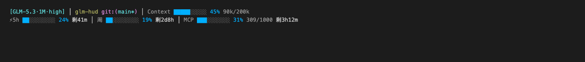

[English](README.en.md) | 中文

# glm-hud

给 GLM Coding Plan 用户的**可分享状态栏**：在 Claude Code 输入框下方常驻两行，一眼看到 **GLM 配额**（5 小时 / 周 / MCP 月度）、**上下文水位**、模型与 git 状态。配额数字来自 Z.ai / BigModel 官方用量接口，不是客户端瞎猜。



```
[GLM-5.3·1M·high] │ glm-hud git:(main*) │ Context █████░░░░░ 45% 90k/200k
⚡5h ███░░░░░░░ 24% 剩41m │ 周 ██░░░░░░░░ 19% 剩2d8h │ MCP ███░░░░░░░ 309/1000 剩3h12m
```

第一行是"你在哪"（模型、项目、分支、上下文余量），第二行是"你还剩多少"（三个配额窗口加重置倒计时，`剩41m` = 还剩 41 分钟）。配额段用量到 75% 变橙、90% 变红并带 ⚠。

## 安装

在 Claude Code 会话里跑三条命令，全程不用手动改任何文件：

```
/plugin marketplace add chen2151643/glm-hud
/plugin install glm-hud
/glm-hud:setup
```

`/glm-hud:setup` 负责接线：自动把 `statusLine` 写进 `~/.claude/settings.json`（写前自动备份；检测到别家的状态栏会先问你）、用样例输入自测渲染、失败自动回滚。Claude Code 会自己重读 settings.json——发一条消息后 HUD 就出现在输入框下方；没出现就重启一次 Claude Code。若 `/glm-hud:setup` 未出现，先跑 `/reload-plugins`。

运行环境：**Node.js ≥ 20**（用内置 fetch），macOS 或 Linux；`git` 可选（没有就静默隐藏分支段）。原生 Windows 不支持，请用 WSL（在 WSL 里装好 Node 后按上面流程安装）。

### 更喜欢用终端？

```bash
git clone https://github.com/chen2151643/glm-hud.git ~/.claude/glm-hud
sh ~/.claude/glm-hud/install.sh
```

`install.sh` 与 `/glm-hud:setup` 等价：写入同一个 `statusLine` 块（含 `refreshInterval: 60`）、同样先备份；遇到第三方状态栏会询问（脚本里非交互环境需加 `--force`）。

**升级**：git clone 安装的用户 `git pull` 即可——settings.json 指向的是路径不是拷贝，无需重跑 install.sh（只有移动/改名目录后才需要重跑）。插件安装的用户在 `/plugin` 里更新即可：状态栏指向稳定路径的转发脚本，会自动跟随最新版本，**无需重跑 setup**。

## 装完你会看到什么

- 新开会话、发出第一条消息后，输入框下方出现两行，样式同顶部示例。
- **第一行（模型/项目/Context）不依赖任何 token，装好必有。**
- **只有第一行、没有 ⚡5h/周/MCP 那一行 = 没识别到 GLM token**——这不是安装失败，见下方常见问题第 1 条。
- 第二行显示灰色 `⚡5h -- 周 -- MCP --` = token 或网络校验失败，90 秒后自动重试（见第 2 条）。
- 手动冒烟测试（不进 Claude Code 也能验证脚本健康）：

```bash
echo '{}' | node ~/.claude/glm-hud/statusline.mjs                # git clone 安装
echo '{}' | node ~/.claude/plugins/glm-hud/statusline.mjs        # 插件安装（稳定路径 launcher）
```

输出至少一行且报错为空即脚本正常。

## 配置

全部配置走环境变量。推荐放在 `~/.claude/settings.json` 的 `env` 块（只影响 Claude Code），也可以放 shell profile（影响所有终端程序）。

| 变量 | 取值 | 默认 | 效果 |
|---|---|---|---|
| `GLM_HUD_THEME` | `dark` \| `light` | `dark` | 配色主题（非法值回落 `dark`） |
| `GLM_HUD_HIDE` | 逗号分隔的段名列表 | *(空)* | 隐藏指定段（未知段名忽略） |

`GLM_HUD_HIDE` 段名与屏幕标签对照（拼写以键名为准，`weekly`、`5h` 这类想当然的拼法会被静默忽略）：

| 屏幕标签 | 键名 | 所在行 |
|---|---|---|
| `[GLM-5.3·1M·high]` 模型徽章 | `badge`（整段）/ `effort`（仅 `·high`） | 1 |
| 项目目录 | `dir` | 1 |
| `git:(main*)` | `branch` | 1 |
| `Context ███ 45% 450k/1M` | `ctx`（整段）/ `ctxabs`（仅 `450k/1M` 数字） | 1 |
| `env默认:flash` 默认模型提示 | `env` | 1 |
| `⚡5h` 五小时窗口 | `fiveHour` | 2 |
| `周` 周窗口 | `week` | 2 |
| `MCP` 月度调用 | `mcp` | 2 |

- `ctx` 隐藏整个 Context 段；`ctxabs` 只隐藏绝对数字，保留进度条和百分比。
- 三个配额段全隐藏 → 第二行整体消失；全部段都隐藏 → 只渲染一行 `[hud]` 哨兵。
- `refreshInterval`（秒，最大 60）是 Claude Code statusline 自身的选项——让倒计时在闲置时也走秒。安装器已写入 `refreshInterval: 60`。配额数字本身在磁盘缓存 90 秒，重绘不产生网络请求。

### 两处设置的优先级

statusline 是 Claude Code 的子进程：settings.json 的 `env` 块在会话启动时注入、盖过从 shell 继承的同名变量。所以**对状态栏而言 settings.json `env` > shell profile**。两处改动都要**新开 Claude Code 会话**才生效。

### 让 agent 配

```
/glm-hud:configure
```

或者直接说：

> 把 glm-hud 换成浅色主题。

> 隐藏 MCP 段。

`/glm-hud:configure` 会带着当前值提问、保存前展示 `旧值 → 新值`、只改 `GLM_HUD_THEME` / `GLM_HUD_HIDE` 两个键、其余配置原样保留。

## 窄终端

段落按固定优先级降级而不是溢出：

- **第 1 行**：env 提示 → Context 绝对数字 → 整个 Context 段 →（最后才）目录/git
- **第 2 行**：MCP 明细 → MCP 段 → 周窗口 → 五小时窗口（最关键的窗口活到最后）
- **< 60 列**：全部折成一行紧凑渲染：`badge | dir | C ████ 22% | ⚡5h ... | 周 ...`
- 兜底 `...` 截断保证输出永不超出终端宽度。

## 常见问题

**1. 没有第二行（看不到 ⚡5h/周/MCP）= 没识别到 GLM token。**
token 按以下顺序取：

1. `ANTHROPIC_AUTH_TOKEN` —— **仅当 `ANTHROPIC_BASE_URL` 指向 GLM 自有域名（含 `bigmodel.cn` 或 `api.z.ai`）时才使用**。用中转/代理地址的用户不会命中这条，这是刻意设计（别家的凭证绝不发往 GLM 的用量接口）。
2. `ZAI_API_KEY`
3. `GLM_API_KEY`

用中转地址的请改设 `ZAI_API_KEY` 或 `GLM_API_KEY` 之一（shell profile 或 settings.json 的 `env` 块均可，新会话生效）。

**2. 第二行显示灰色 `⚡5h -- 周 -- MCP --` = token 或网络校验失败。**
无 token / 错 token / 断网三种失败在屏幕上是同一个灰占位（刻意不区分，避免把错误细节打进状态栏）；90 秒后自动重试，恢复后自动变回数字。可先跑上面"装完你会看到什么"里的冒烟测试分辨脚本与环境的责任。

**3. 怎么验证装好了？** 新开会话发一条消息，输入框下方应出现两行（样式同顶部示例）。只有第一行时按第 1 条排查 token。

**4. 升级要重跑 setup 吗？** 不用。git clone 安装：`git pull` 即可；插件安装：`/plugin` 更新即可——状态栏指向的 launcher 会在每次渲染时自动挑最新版本。

**5. 为什么是 statusline，而不是插件 band/面板？** Claude Code 的插件 UI（band/面板）渲染在输入框**上方**、只收单行纯文本；输入框**下方**多行、带 ANSI 颜色的形态只有 statusLine 命令这一条通道。所以 glm-hud 用插件做分发（marketplace 一键安装 + `/glm-hud:setup`、`/glm-hud:configure` 两个命令），渲染本体是 statusLine 脚本——与 claude-hud 同款架构。

**6. Windows？** 原生 Windows 不支持（接线层依赖 POSIX 路径与 `$HOME` 展开），请用 WSL。脚本本身跨平台，欢迎 PR 补 Windows 接线。

## 空闲时会更新吗？

会。Claude Code 默认只在每条消息、权限切换等事件后重绘状态栏（空闲时静止——这是引擎默认行为，claude-hud/ccstatusline 相同）。本项目的 `install.sh` 与 `/glm-hud:setup` 会自动写入 `statusLine.refreshInterval: 60`（引擎强制每 60 秒重绘，官方机制，上限 60s）。倒计时在最后一小时内带秒位（`剩41m07s`），空闲期也能看到它在走；限额百分比来自服务端，无人消耗 token 时本就不变。

## 工作原理与 token 安全

- `statusline.mjs` 从 stdin 读状态栏 JSON，输出最多两行到 stdout，**永远 exit 0**——坏 payload、缺 git、断网都不会弄坏你的提示符。
- `quota.mjs` 请求 `GET {base}/api/monitor/usage/quota/limit`（BigModel 国内或 Z.ai 国际，按 `ANTHROPIC_BASE_URL` 选择），token 放在 `Authorization` 头，结果缓存到 `cache/quota.json`（权限 0600、TTL 90 秒、原子写）；失败沿用上一次好快照。
- `parse.mjs` / `render.mjs` 为纯函数：配额窗口分类（`unit=3×5` → 5 小时、`unit=6×1` → 周、含更早重置兜底）、主题调色板、宽度计算（CJK 按 2 列）与降级。
- **token 只从进程环境读取**，只发往匹配的配额端点（`open.bigmodel.cn` 或 `api.z.ai`），不落日志、不写盘、不硬编码。没配 token → 配额段省略，其余照常渲染。

## 开发

```bash
node --test        # 101 个测试：解析、渲染、降级、主题、端到端管道
```

调色板测试对深浅两种背景计算 WCAG 对比度，任一颜色跌破 4.5:1（粗体/进度条 3:1）即失败。`preview/` 里是各场景渲染截图与 ANSI 原文，由 `tools/gen-scenes.mjs` 生成。

## License

[MIT](LICENSE)
